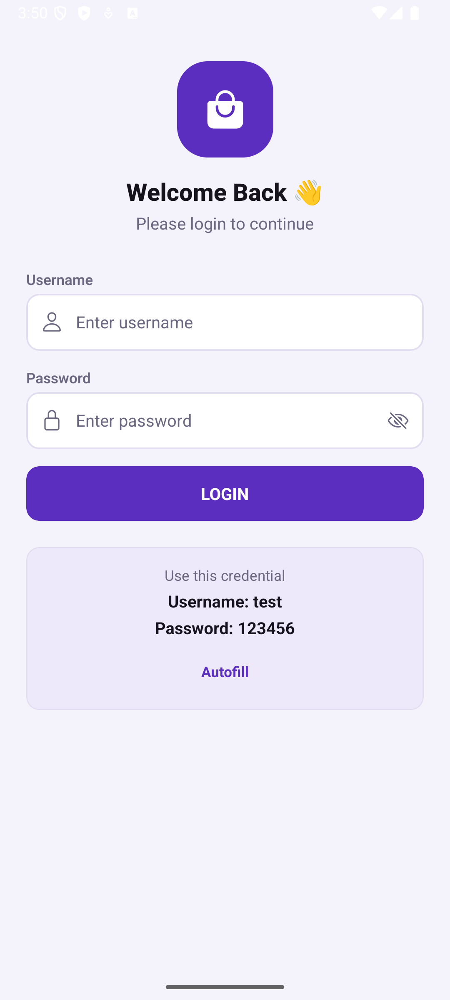
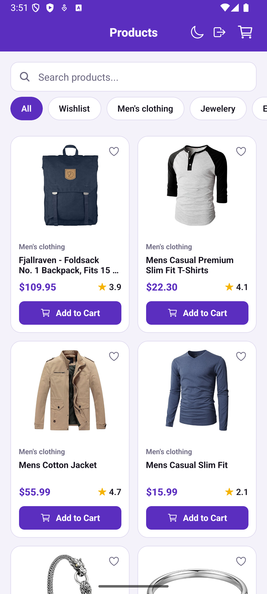
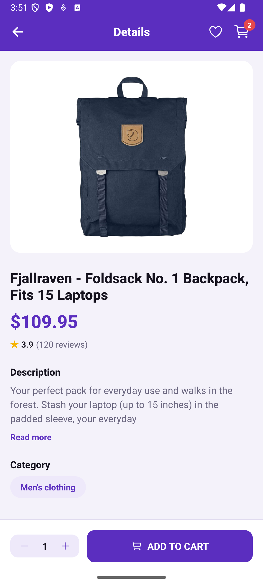
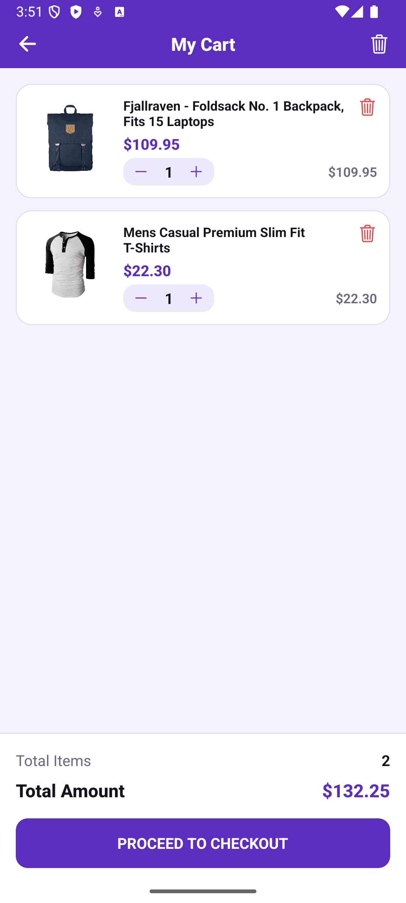
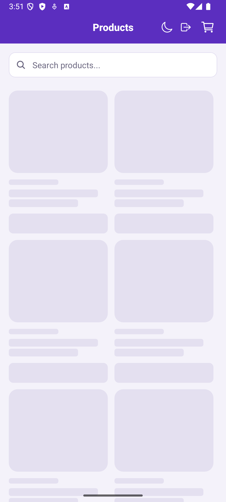

# ShopEasy – React Native E-Commerce App

A React Native CLI (TypeScript) e-commerce app built on the [Fake Store API](https://fakestoreapi.com/products).

## Features

- Splash screen with persisted-login check (auto-routes to Products or Login)
- Login with validation (static credentials `test` / `123456`), login state stored in AsyncStorage
- Product list: 2-column grid, pull to refresh, skeleton loader, error / offline / empty states with Retry
- Product details: image, description, price, rating, category, quantity selector, Add to Cart
- Cart: add, increase, decrease, remove, no duplicates (quantity merges), totals, persisted across restarts
- Live cart badge in the header of every relevant screen
- Skeleton placeholders on Login, Product List, Product Details and Cart
- Bonus: debounced search, category filter, wishlist, dark mode, infinite scroll, image caching, animations, TypeScript, unit tests

## Setup

Prerequisites: Node >= 22.11, JDK 17, Android SDK (see the React Native environment guide).

```bash
npm install
npm start
npm run android
```

Release APK:

```bash
cd android && ./gradlew assembleRelease
```

The built APK is committed at `apk/ShopEasy.apk`.

Run tests:

```bash
npm test
```

## Libraries

| Library | Purpose |
| --- | --- |
| react-native 0.87 (CLI) | Framework |
| @react-navigation/native, native-stack | Navigation |
| axios | API requests |
| @reduxjs/toolkit, react-redux | State management |
| redux-persist + @react-native-async-storage/async-storage | Persist cart, auth, wishlist, theme |
| react-native-skeleton-placeholder | Skeleton loaders |
| react-native-linear-gradient, @react-native-masked-view/masked-view | Skeleton shimmer |
| @react-native-community/netinfo | Offline detection |
| react-native-vector-icons | Icons |
| react-native-safe-area-context, react-native-screens | Layout / navigation primitives |
| jest | Unit tests |

## Folder structure

```
src/
  api/          axios client, endpoints, product API calls
  components/   reusable UI (Button, Input, ProductCard, CartItem, QuantityStepper,
                Rating, CartBadge, EmptyState, ErrorState, OfflineBanner, Toast,
                SearchBar, CategoryChips, ScreenHeader, skeletons/)
  hooks/        useDebounced, useNetwork, useProduct, useRehydrated, useToast, useSkeletonDelay
  navigation/   RootNavigator, route types
  screens/      Splash, Login, ProductList, ProductDetails, Cart
  store/        store, typed hooks, selectors, slices (auth, cart, products, wishlist, theme)
  theme/        design tokens (light / dark), ThemeProvider
  types/        shared TypeScript types
  utils/        validators, formatters, error mapping
__tests__/      cart slice, selectors, validators
apk/            release APK
screenshots/    app screenshots
```

## Screenshots

| Splash | Login | Products |
| --- | --- | --- |
|  |  |  |

| Details | Cart | Skeleton (list) |
| --- | --- | --- |
|  |  |  |

## Time taken

_TODO: fill in before submitting._

## Assumptions

- The brief hardcodes `GET /products/10` for details. The app fetches `/products/:id` for the tapped product, which returns the same shape.
- The Login and Cart skeletons show briefly (about 0.5 s) on mount, since neither screen has an API call but the brief asks for skeletons on them.
- Checkout is a stub: it shows a confirmation and clears the cart.
- Static credentials live in `src/utils/validators.ts`.
- Image caching uses the native image cache (`cache: 'force-cache'`).
